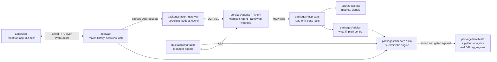

# Touchline

Touchline is a football match simulation calibrated to real tracking data, with a team of AI agents that explain the match as it unfolds. A deterministic engine plays fictional clubs at 10 frames per second; Python [Microsoft Agent Framework](https://github.com/microsoft/agent-framework) agents, served over A2A and reading all numbers through an MCP stats server, turn the stream into fact-checked, personalised cues in English, Spanish and Hindi.

**Headline feature, "Pause and ask the match".** Freeze any frame of the match and ask a question in EN, ES or HI ("why didn't he pass to the winger?"). A visible team of agents (question agent, analyst, fact-checker, personaliser) parses the question, gathers evidence from the stats server, re-simulates the alternative over many seeds, checks every number it is about to state, and answers in the viewer's language. "Show me" plays the real moment next to the re-simulated one in 3D. When the re-simulation cannot tell the options apart, the answer says "too close to call" instead of overclaiming. Demo moments: `docs/demo/ask-moments.md`; design: `docs/superpowers/specs/2026-10-22-pause-and-ask-design.md`.

All clubs, players and matches are fictional and generated by our own simulator. Only aggregate statistics from the open IDSSE/DFL dataset (CC-BY 4.0) are used and committed; see [Licence and attribution](#licence-and-attribution).

## Architecture



The API serves recorded runs ("library" folders of tracking, events and cached cues) and can call the agent service live. Agents never compute a statistic: every number comes from an MCP tool call or the re-simulation, and the Fact-Checker rejects any number that does not match.

## The agents

| Agent | Role |
|---|---|
| Moment Detector | Promotes stats signals (goals, pressure shifts, momentum swings, big chances) to moments worth explaining |
| Tactical Analyst | Explains a moment from MCP evidence; in Ask, drafts the answer from the frozen frame and the re-simulation numbers |
| Narrator | Writes the English draft with every number declared |
| Fact-Checker | Checks every number, name and comparison against the stats server; one retry, then unverified sentences are dropped |
| Personalizer | Writes each viewer segment's cue natively in English, Spanish or Hindi from verified claims only |
| Recap Producer | Half-time and full-time recaps |
| Question agent (Ask) | Turns a free-text question plus the frame into a structured intent (`explain`, `what_if`, or an honest `unsupported`) |
| Manager agents | Propose and choose tactical changes at key moments, tested by re-simulation (`packages/manager`) |

Flow for a match moment: Detector -> Analyst -> Narrator -> Fact-Checker (retry once back to the Narrator) -> Personalizers -> publisher (`services/agents/touchline_agents/workflow.py`). Every agent has a deterministic fallback and a per-agent timeout. The agent service exposes the skills `moments`, `recap`, `manage` and `ask` over A2A.

## Microsoft and Azure technology actually used

- **Microsoft Agent Framework** (`agent-framework-core`, `agent-framework-openai`): the agent workflow graph, agents, executors and checkpointing.
- **Agent2Agent (A2A) protocol**: the agent service is an A2A server (`a2a-sdk`); the TypeScript gateway is an A2A client (`@a2a-js/sdk`).
- **Model Context Protocol (MCP)**: the stats server (`packages/mcp-stats`, stdio or Streamable HTTP) is the only way agents read the match.
- **Models**: OpenAI models (`gpt-6.1-sol` by default, `gpt-5.4-mini` for the fast tier) through the Agent Framework OpenAI client, selected with `TOUCHLINE_LLM=openai` and `OPENAI_API_KEY`. A deterministic stub model is the default.
- **Not used**: this repository does not deploy to Azure or call Azure OpenAI or Microsoft Foundry. The early design spec planned that; it was not built, and the evaluation rows are only shaped so they could be sent to Foundry/azure-ai-evaluation later.

## Quickstart

Prerequisites: Node.js >= 22 (`.nvmrc` pins 22), pnpm 11 (`corepack enable`), [uv](https://docs.astral.sh/uv/) with Python 3.12 for the agent service (3.11+ for `python/analytics`). No API key is needed: with the default stub model everything runs offline.

```bash
corepack enable
pnpm install
pnpm league                       # regenerate data/league/league.json (deterministic)
pnpm test                         # TypeScript tests (agents use the stub model)

# Terminal 1: the agent service on http://127.0.0.1:8100/ (stub model)
uv run --project services/agents touchline-agents

# Terminal 2: simulate the six demo scenarios and cache their cues into out/library
pnpm library

# Terminal 3: API on :8787 and the fan app on http://localhost:5173
pnpm dev
```

Open http://localhost:5173, start a match, pause it, and use the Ask panel. `pnpm library --no-agents true` builds a stats-only library if you do not want to start the agent service.

With a real model, put `OPENAI_API_KEY=...` in the git-ignored `.env.local` (template: `.env.example`) and start the service with `TOUCHLINE_LLM=openai`. A real model takes about 5 s per call, so a match moment takes about 30 s: real-model runs are recorded and replayed, while typed Ask questions run live. Details, flags and the other CLIs (`pnpm sim`, `pnpm stats`, `pnpm mcp-stats`, `pnpm manage`, `pnpm managers:ab`) are in `docs/guide.md`.

Single match to files: `pnpm sim --seed 1 --home ironmoor --away saltmarsh` writes `out/m-1/` (CDF v0.3.2 tracking and events); validate it with `uv run --project python/analytics python -m touchline_analytics.validate_cdf out/m-1`.

Agent evaluation against scripted ground truth (stub model, no key): `uv run --project services/agents touchline-eval suite --suite ci`.

## How realism is measured

The engine is tuned by the method of simulated moments to reproduce statistics measured on seven real matches of the open IDSSE/DFL dataset (passes, shots, duels, set pieces, player movement, physics of the ball), then held-out simulated matches are compared with the real ones, statistic by statistic, in standard deviations.

- `pnpm realism --matches 16 --out out/realism.md` generates a report like the committed `docs/realism/realism-report.md` (every statistic labelled within 1 SD, within 2 SD or off, including the ones that are off).
- The realism gate (`packages/calibrate/test/realism-gate.test.ts`, run by `pnpm test`) simulates 16 further held-out matches and fails if any statistic moves more than 3.5 standard errors from the committed baseline or drifts from the real targets.
- `pnpm calibrate` runs the tuner; the real data download is `uv run --project python/analytics python -m touchline_analytics.idsse` (into git-ignored `data/raw/`).
- Reports and per-phase diagnostics: `docs/realism/`, `docs/physics-calibration.md`; agent evaluations: `docs/evals/`.

## Repository layout

| Path | What it is |
|---|---|
| `apps/web` | Fan app (React, Vite, Tailwind): 2D/3D pitch, overlays, Ask panel, studio console, graphics output, ops view |
| `apps/api` | Effect RPC/WebSocket server: match library, sessions, Ask, live agents |
| `packages/sim-core`, `packages/sim`, `packages/league` | Match engine, run writers/CLI, fictional league generator |
| `packages/stats`, `packages/mcp-stats`, `packages/advisor` | Metrics and signals, MCP server, what-if and positioning advisor |
| `packages/agent-gateway`, `packages/manager`, `packages/schema`, `packages/rpc` | A2A client, manager agents, shared schemas and RPC contracts |
| `packages/calibrate`, `python/analytics` | Calibration, realism gate; CDF validation, real-data targets, model fitting |
| `services/agents` | Python Microsoft Agent Framework agents, A2A server, evaluation harness |
| `data/` | Fictional league, calibrated parameters (aggregates only), real-player name blocklist (hashes) |
| `docs/` | `guide.md` (command reference), `realism/`, `evals/`, `demo/`, `superpowers/` (specs and plans) |

## Licence and attribution

Code: MIT, see `LICENSE`. Calibration targets and fitted parameters derived from the IDSSE/Sportec open DFL dataset are shared under CC-BY 4.0 with credit to the Deutsche Fussball Liga (DFL) and Bassek et al., *Scientific Data* (2025). Third-party ideas, ported code (pitch control, MIT) and 3D assets (CC0) are credited in [`ATTRIBUTION.md`](ATTRIBUTION.md).
